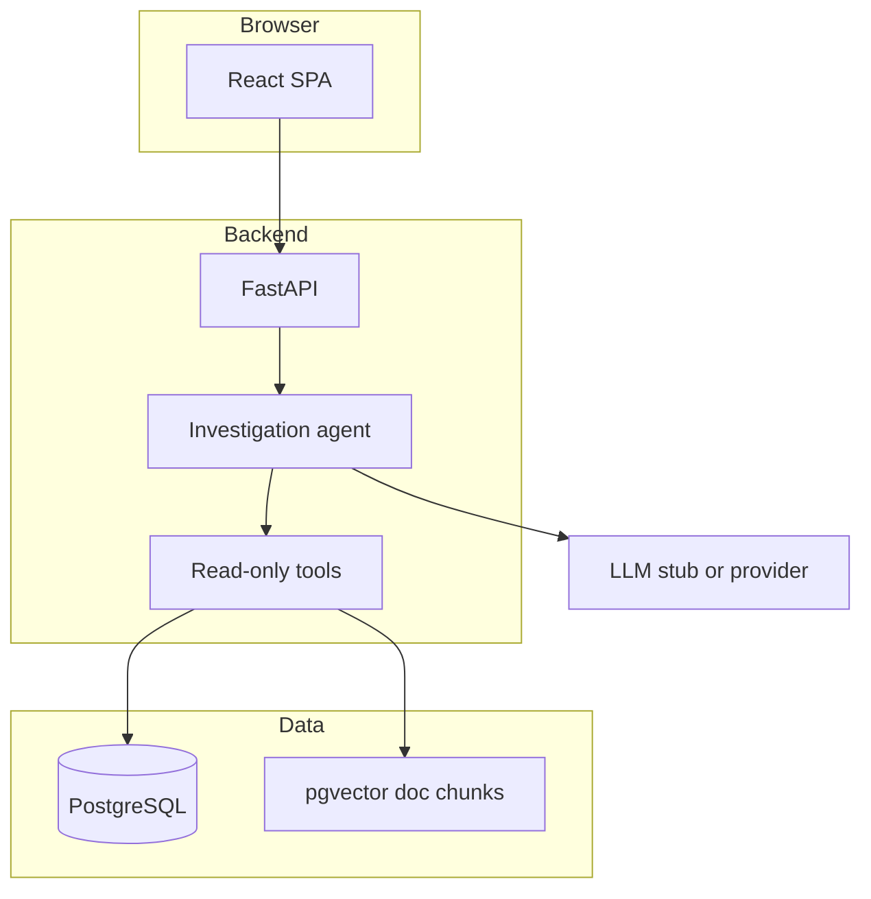

# FinPilot AI

AI-assisted **payment failure investigation** for operations engineers. FinPilot combines payment records, events, logs, and internal documentation (RAG) into a single investigation flow with evidence, sources, and recommendations.

Built as a 30-day portfolio MVP: React + FastAPI + PostgreSQL (pgvector) + tool-calling agent.

## What you can demo

1. Search and open failed payments (e.g. **PAY-1001**).
2. Inspect timeline, gateway events, and logs.
3. Run **Investigate** — agent calls read-only tools, retrieves docs, returns structured RCA.
4. Review saved investigation history.

See **[Sample investigation (PAY-1001)](docs/sample-investigation.md)** for API examples and expected output.

## Screenshots

| Payments | Investigation result |
| --- | --- |
|  |  |

*(SVG mockups aligned with the seeded PAY-1001 scenario; swap in PNG captures from your local UI anytime.)*

## Architecture

High-level design and sequence diagrams: **[docs/architecture.md](docs/architecture.md)**



## Stack

| Layer | Tech |
| --- | --- |
| Frontend | React, TypeScript, Vite, TanStack Query |
| Backend | FastAPI, SQLAlchemy, Alembic |
| Database | PostgreSQL 16 + pgvector |
| AI | Tool calling, RAG over `docs/`, structured RCA JSON |

## Prerequisites

- [Docker](https://docs.docker.com/get-docker/) (OrbStack, Docker Desktop, etc.)
- Python 3.12+ and Node.js 20+

## Setup

### One-command bootstrap (new machine)

```bash
git clone <your-repo-url> finpilot-ai && cd finpilot-ai
npm run setup
```

This creates `.env`, starts Postgres (`docker compose up -d --wait`), installs Python and frontend deps, runs migrations, and seeds demo data.

### Run the app

```bash
npm run dev:api    # terminal 1 — http://127.0.0.1:8000
npm run dev:web    # terminal 2 — http://localhost:5173
```

Open the UI and search for **PAY-1001**, then **Investigate**.

### Verify

```bash
npm run verify     # DB connectivity (+ API if dev:api is running)
npm run test:api   # 130+ backend tests (Postgres required)
```

### Fresh database

```bash
npm run setup:fresh   # docker compose down -v + full bootstrap
# or
npm run db:reset      # reset volume, migrate, seed (keeps .venv)
```

### Manual setup (equivalent to `npm run setup`)

1. `cp .env.example .env`
2. `npm run db:up`
3. `python3 -m venv .venv && .venv/bin/pip install -r backend/requirements.txt`
4. `cd backend && ../.venv/bin/alembic upgrade head && ../.venv/bin/python -m app.seed`
5. `npm install --prefix frontend`

The Vite dev server proxies `/api` and `/health` to the API. The header shows **API connected** when the backend and database are healthy.

## Project structure

```text
finpilot-ai/
├── frontend/          # React UI
├── backend/app/       # FastAPI, agent, tools, RAG
├── docs/              # RAG corpus + architecture + sample investigation
├── scripts/           # bootstrap.sh, verify-setup.sh
├── docker-compose.yml # PostgreSQL only (API/UI on host)
└── .env.example
```

## Commands

| Command | Description |
| --- | --- |
| `npm run setup` | First-time bootstrap |
| `npm run setup:fresh` | Wipe DB volume and bootstrap |
| `npm run verify` | Smoke-check setup |
| `npm run db:up` / `db:down` | Start / stop Postgres |
| `npm run db:reset` | Reset DB and re-seed |
| `npm run dev:api` | FastAPI with reload |
| `npm run dev:web` | Vite dev server |
| `npm run test:api` | Pytest suite |

## Security

Local MVP with no auth. Secrets stay in `.env`; investigation tools are read-only. See **[SECURITY.md](SECURITY.md)**.

## Documentation

| Doc | Purpose |
| --- | --- |
| [docs/architecture.md](docs/architecture.md) | Diagrams and module layout |
| [docs/sample-investigation.md](docs/sample-investigation.md) | PAY-1001 walkthrough + curl |
| [docs/*.md](docs/) | Payment ops corpus (RAG) |

## Milestones

- **v0.1** — Payment data (API + seed)
- **v0.2** — Payment UI
- **v0.6** — Investigation workflow + SSE
- **v0.7** — Backend tests + RAG evaluation
- **Portfolio** — README, architecture, sample investigation *(current)*
