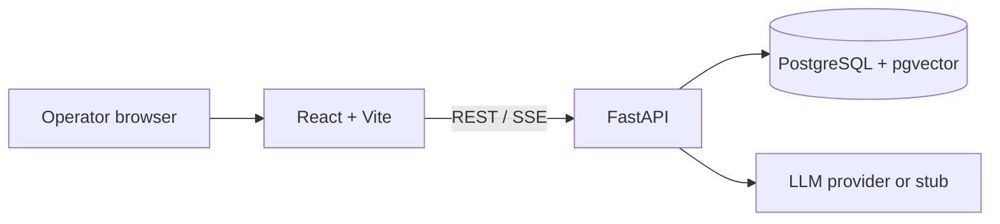
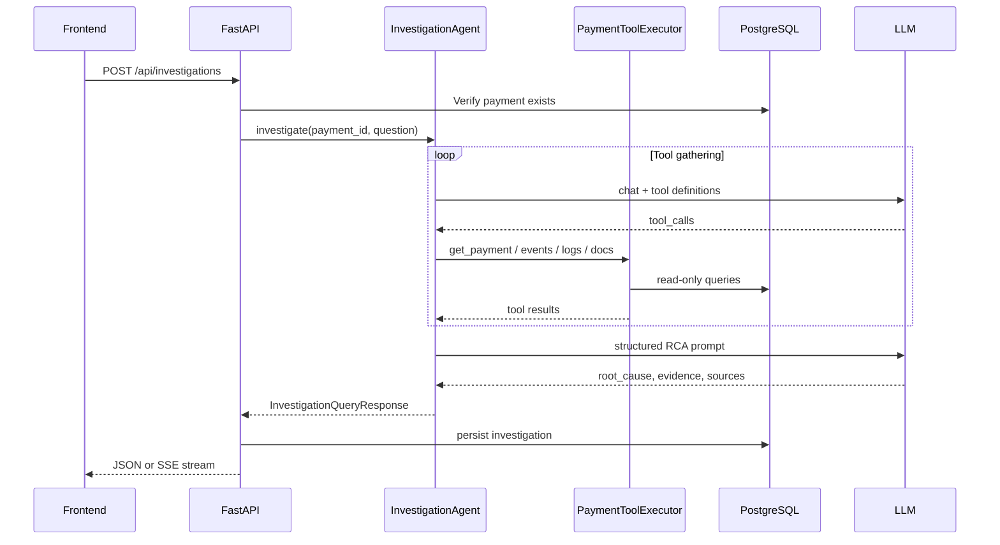

# FinPilot architecture

FinPilot is a **modular monolith**: one FastAPI service, one React SPA, and PostgreSQL with **pgvector** for documentation RAG. The investigation agent calls **read-only tools** and returns structured RCA JSON with evidence and sources.

## System context

## Investigation flow

## Backend layout

| Layer | Responsibility |
| --- | --- |
| `routers/` | HTTP API (payments, investigations, dev LLM chat) |
| `services/` | Investigation agent, RCA, evidence rules, payment service |
| `tools/` | Read-only tool executor (`get_payment`, events, logs, doc search) |
| `repositories/` | SQLAlchemy data access |
| `documentation/` | Markdown corpus, chunking, embeddings index |
| `llm/` | Provider routing, stubs, rate limits |

## Data stored

- **Payments** — amount, status, gateway, `error_code`
- **Events** — lifecycle (`PAYMENT_CREATED` → `GATEWAY_RESPONSE`)
- **Logs** — service messages for search
- **Documents + chunks** — ops docs with vector embeddings
- **Investigations** — saved RCA runs per payment

## Security (MVP)

- No auth on local API; see [SECURITY.md](../SECURITY.md).
- Payment IDs and payloads validated; tools cannot write to the database.
- Secrets only in `.env`, never committed.
